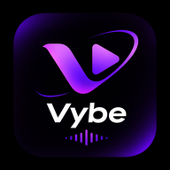

# 🎵 Vybe

<p align="center">
  
</p>

<h1 align="center">Your Music. Your Rules. Your Vybe.</h1>

<p align="center">
  <strong>Done with ads? Ready for a better music experience?</strong>
  <br />
  Stream, discover, download, and enjoy your favourite music — without interruptions.


<p align="center">
  <a href="https://github.com/Shubham-Loshali/Vybe/releases/tag/v10.6.2">
    
  </a>
</p>
<p align="center">
  <a href="https://github.com/Shubham-Loshali/Vybe/releases">All Releases</a> •
  <a href="#-features">Features</a> •
  <a href="#-installation">Installation</a> •
  <a href="#-contributing">Contribute</a>
</p>

<p align="center">
  
  
  
  
</p>

---

## 🌊 What is Vybe?

**Vybe** is a modern, lightweight, and open-source music streaming application built with Flutter.

We believe listening to music should be simple. No unnecessary interruptions, no expensive subscriptions, and no complicated setup.

Vybe brings together everything you need for an enjoyable music experience — online streaming, offline downloads, playlist management, synchronized lyrics, and personalized listening statistics.

Whether you're discovering new tracks or revisiting your favourites, Vybe lets you enjoy music your way.

**Why settle for less when you can find your Vybe?**

---

## ✨ Features

### 🎧 Music Streaming
- Search and discover music with intelligent suggestions.
- Seamless background playback.
- Rich notification and lock-screen controls.
- Android Auto compatibility.

### 📥 Offline Downloads
- Download individual tracks and playlists.
- Save music for offline listening.
- Local caching for a smoother listening experience.

### 🔄 Spotify Playlist Import
- Import public Spotify playlists using their URLs.
- Automatically match tracks and add them to your library.
- Bring your existing playlists into Vybe.

### 🎤 Synchronized Lyrics
- Real-time synchronized lyrics.
- LRC format support with karaoke-style scrolling.
- Cache lyrics for offline access.

### 🎚️ Audio Equalizer
- Multi-band equalizer.
- Custom audio presets.
- Personalize your listening experience.

### 📡 Internet Radio
- Explore radio stations from different genres.
- Discover stations from around the world.

### 📊 Listening Statistics
- Track your listening history.
- Discover your most-played tracks and artists.
- View listening time and personalized recap cards.

### 📲 Peer-to-Peer Device Sync
- Sync playlists, favourites, and your music library.
- Connect devices over the same Wi-Fi network.
- No third-party cloud server required for local sync.

### 🎨 Beautiful Interface
- Modern Material You design.
- Dynamic colors on supported Android devices.
- Dark, Light, and AMOLED themes.
- Customizable accent colors.

### 🌍 Multilingual Support
- Localized interface in 20+ languages.

---

## 📱 Screenshots

<p align="center">
  <!-- Add your app screenshots here -->
  <i>Coming soon</i>
</p>

---

## 📥 Installation

### Android

<p align="center">
  <a href="https://github.com/Shubham-Loshali/Vybe/releases/tag/v10.6.0">
    
  </a>
</p>

1. Visit the [Vybe v10.6.2 Release Page](https://github.com/Shubham-Loshali/Vybe/releases/tag/v10.6.2).
2. Download the APK asset.
3. Open the downloaded APK on your Android device.
4. Follow the installation instructions.

**Minimum Requirements**
- Android 8.0 (API 26) or higher.

---

## 🛠️ Built With

| Technology | Purpose |
|---|---|
| Flutter | Cross-platform UI framework |
| Dart | Programming language |
| just_audio | Audio playback |
| audio_service | Background audio |
| audio_session | Audio session management |
| Hive CE | Local database and caching |
| GoRouter | Navigation and routing |
| Dynamic Color | Material You theming |
| RxDart | Reactive programming |
| HTTP | Networking |

---

## 🔒 Privacy First

Your music experience should remain yours.

Vybe is designed with privacy in mind:

- No telemetry or analytics trackers.
- No mandatory account or registration.
- Playback history and preferences stored locally.
- Local peer-to-peer synchronization.
- No central cloud account required.

---

## 🤝 Contributing

Vybe is open source, and contributions are welcome!

Want to improve Vybe, fix bugs, or introduce new features? We'd love your help.

1. Fork this repository.
2. Create a feature branch.
   ```bash
   git checkout -b feature/amazing-feature
   ```
3. Commit your changes.
   ```bash
   git commit -m "feat: add amazing feature"
   ```
4. Push your branch.
   ```bash
   git push origin feature/amazing-feature
   ```
5. Open a Pull Request.

Before submitting, run:

```bash
flutter analyze
```

---


## ⚠️ Disclaimer

Vybe is an independent, open-source project and is not affiliated with, endorsed by, or officially connected to Spotify, YouTube, or any other music service.

Third-party names and trademarks belong to their respective owners. Music availability and usage are subject to the respective providers' terms, licensing, and applicable copyright laws.

---

<p align="center">
  <strong>Made with ❤️ for music lovers.</strong>
  <br />
  <h2 align="center">Find Your Vybe. 🎶</h2>
</p>

<p align="center">
  <a href="https://github.com/Shubham-Loshali/Vybe/releases/tag/v10.6.2">⬇ Download Vybe</a>
  &nbsp; • &nbsp;
  <a href="https://github.com/Shubham-Loshali/Vybe">⭐ Star on GitHub</a>
</p>
